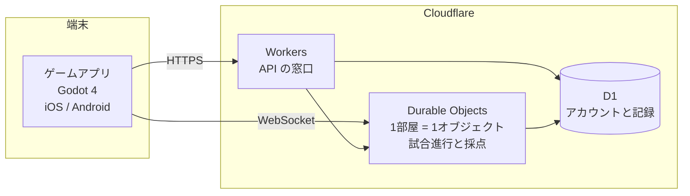

# 技術設計書　水平を探せ（仮題）

| 項目 | 内容 |
|---|---|
| 版 | v0.1（草案） |
| 作成日 | 2026-11-12 |
| 前提 | `docs/01_requirements.md`（要件定義書 v0.4） |
| 方針 | まず簡易的なもので作り、遊びが成立することを確認してから作り込む |

本書は、要件定義書の内容をどの技術でどう実現するかを定める。数値（送信間隔、待ち時間など）は初期値であり、試作で調整する。

## 1. 全体構成



| 構成要素 | 役割 | 使い始める段階 |
|---|---|---|
| ゲームアプリ（Godot 4） | 描画、操作、移動、他の参加者の表示 | 段階1 |
| Workers | 部屋の作成と参加、アカウント、購入検証の窓口 | 段階2 |
| Durable Objects | 1部屋を1つのオブジェクトとして扱い、試合の進行、設置面の占有、アイテム、採点を行う | 段階2 |
| D1 | アカウント、自己最高記録、購入履歴の保存 | 段階3 |
| R2 | 追加ステージなどの大きなデータの配信 | 必要になった時点 |

Workers の無料プランでも、SQLite を使う Durable Objects を1日あたりの上限付きで利用できる（https://developers.cloudflare.com/durable-objects/platform/pricing/ ）。WebSocket で端末から受け取るメッセージは、20件で1リクエストとして数えられる。1試合（8人、10回/秒の送信、90秒×3ラウンド）では約1,100リクエスト相当になり、無料枠の1日10万リクエストで1日あたり約90試合を処理できる計算になる。この数値は本書での試算であり、料金と上限は公式ページで確認する。

## 2. 開発環境

### 2.1 使用するソフトウェア

| 用途 | ソフトウェア | 使う場所 |
|---|---|---|
| ゲームエンジン | Godot 4（着手時点の最新安定版に固定する） | PC |
| 3Dモデル制作 | Blender | PC（段階1の後半から） |
| ソースコード管理 | Git、GitHub | PC とクラウドの Claude Code |
| Android の動作確認 | Android Studio のエミュレータ | PC |
| iOS のビルドと配信 | Codemagic → TestFlight | クラウド → iPhone 17 |
| サーバの開発 | Node.js、Wrangler（Cloudflare の公式ツール） | クラウドの Claude Code、GitHub Actions |

Godot の最新安定版は、2026年8月時点で 4.7.2 と報じられている。4.8 はベータ版である。着手時に公式サイト（https://godotengine.org/ ）で確認し、採用したバージョンを本書に記録する。プロジェクトの途中でバージョンを上げる場合は、別の作業として扱う。

### 2.2 作業の流れ

1. Claude Code がコードとシーンファイルを作成し、作業用ブランチにコミットしてプッシュする。
2. PC で GitHub から最新の内容を取得し、Godot エディタで実行して動作を確認する。
3. 確認した内容を `main` ブランチに取り込み、Codemagic で iOS 版をビルドして TestFlight に配信する。iPhone 17 で確認する。

### 2.3 リポジトリの構成

```
/
├─ docs/                 企画書、要件定義書、技術設計書
├─ game/                 Godot プロジェクト
│  ├─ scenes/            画面とステージ
│  ├─ scripts/           GDScript
│  ├─ assets/            Godot に取り込む3Dモデル、音、画像
│  └─ tests/             採点などの自動テスト
├─ shared/
│  └─ stages/            ステージ定義（JSON）。端末とサーバの両方が使う
├─ server/               Cloudflare Workers（TypeScript）
├─ art-src/              Blender の元データ（.blend）
├─ codemagic.yaml        アプリのビルド設定
└─ .github/workflows/    サーバのテストとデプロイ
```

## 3. ゲームアプリの設計

### 3.1 使用言語とレンダラー

ゲームのスクリプトは GDScript で書く。Godot の標準言語であり、テキストファイルとして Claude Code が直接編集できる。

レンダラーは Compatibility レンダラー（OpenGL ES 3.0 系）を第一候補とする。対応する端末の範囲が最も広く、単純な形状が中心の簡易版に適しているためである。描画の品質を上げる段階で、Mobile レンダラーへの切り替えを検討する。

### 3.2 画面構成

| 画面 | 段階1 | 段階2以降 |
|---|---|---|
| タイトル | 開始ボタンのみ | 部屋の作成、部屋番号の入力 |
| 待機室 | なし | 参加者一覧、開始ボタン |
| ステージ | 一人で探索と設置 | 他の参加者とアイテムを表示 |
| 結果 | 自分の得点の内訳 | 全員の置き場所と内訳 |

### 3.3 操作

| 操作 | 方法 |
|---|---|
| 移動 | 画面左半分の仮想スティック |
| 視点 | 画面右半分のスワイプ |
| 置く、持ち上げる、確定する | 画面右下のボタン。状態に応じて表示を切り替える |
| アイテムを拾う、使う | 段階2で追加する |

置く位置は、画面中央から視線の方向に伸ばした線と設置面が交わる点とする。水平器の底面が設置面からはみ出す場合は、設置面の内側に収まる位置へ寄せる（要件定義書 4.1節4項の位置補助）。

### 3.4 設置面の表示と傾き

各設置面の傾きは、端末には送らない（要件定義書 5.1節4項）。家具は傾けずに描画する。要件で扱う傾きは 0.01°〜1° 程度であり、画面上で見分けられる大きさではないため、見た目への影響はない。

測定結果は、水平器を置いて安定した後に、サーバから置いた本人にだけ送る。段階1はサーバを使わないため、傾きを端末内で生成する。

## 4. 設置面とステージの定義

設置面は、ステージごとの JSON ファイル（`shared/stages/`）で定義する。端末とサーバが同じファイルを使うことで、両者の食い違いを防ぐ。

```json
{
  "stage_id": "room01",
  "surfaces": [
    {
      "id": "desk_top",
      "center": [1.2, 0.72, -0.5],
      "size": [1.0, 0.6],
      "yaw_deg": 0,
      "place_points": 10,
      "tilt_range_deg": [0.0, 0.8]
    }
  ],
  "item_spawns": [[0.5, 0.0, 2.0], [3.1, 0.9, -1.2]]
}
```

| 項目 | 意味 |
|---|---|
| `center`、`size`、`yaw_deg` | 設置面の位置、大きさ（幅と奥行き、メートル）、向き。設置面は長方形とする |
| `place_points` | 場所点 |
| `tilt_range_deg` | 試合ごとに傾きを決めるときの範囲 |
| `item_spawns` | アイテムを置く候補の位置。試合ごとに、ここからランダムに選ぶ |

Godot のステージのシーンには、JSON の `id` と同じ名前の設置面ノードを置く。シーンと JSON の内容が一致しているかは、自動テストで確認する。

## 5. 傾きの表し方と採点

### 5.1 傾きの表し方

設置面の傾きは、傾きの大きさ θ（度）と、低くなる方向 φ（度、ステージ上の方位）の二つの値で表す。サーバが試合の開始時に、各設置面について次のように決める。

- θ：`tilt_range_deg` の範囲から無作為に選ぶ。
- φ：0°〜360° から無作為に選ぶ。

水平器を向き ψ で置いたときの2軸の表示値は、次の式で求める。

- 前後の傾き = atan(tan θ × cos(φ − ψ))
- 左右の傾き = atan(tan θ × sin(φ − ψ))

採点には、2軸を合成した値として θ そのものを使う。どちらか一方の軸だけが水平になる置き方をしても、θ は変わらない。このため、一方向だけ水平に見える置き方で高得点にはならない（要件定義書 4.1節3項）。

### 5.2 得点の計算

| 項目 | 計算式（t は開始から安定までの秒数） |
|---|---|
| 水平点 | 70 × (1 − θ ÷ 1°)。θ が 1° 以上の場合は、その記録全体を無効とする |
| 場所点 | 設置面の `place_points` |
| 時間点 | 10 × (1 − t ÷ 90) |
| 合計 | 端数処理をせずに合計し、表示は小数第1位までとする |

安定した時刻は、サーバが設置を受け付けた時刻に、全員共通の安定待ち時間（初期値1.0秒）を加えた時刻とする。通信の遅れによる差は、数十ミリ秒であれば時間点で0.01点未満となり、得点への影響はほぼない。設置面を先に取る競争では、通信の遅れが勝敗に影響する可能性がある。簡易版では補正を行わず、試作で影響を確認する。

### 5.3 自動テスト

企画書 03章の計算例を、採点処理の自動テストに使う。端末とサーバの両方の採点処理が、同じ結果を返すことを確認する。

| θ | t | 場所点 | 期待する合計 |
|---|---|---|---|
| 0.01° | 10秒 | 0 | 78.2 |
| 0.05° | 30秒 | 10 | 83.2 |
| 0.08° | 55秒 | 20 | 88.3 |
| 0.60° | 70秒 | 20 | 50.2 |

## 6. アイテムの設計（段階2）

| 項目 | 設計 |
|---|---|
| 配置 | 試合の開始時に、サーバが `item_spawns` から位置を選んで各アイテムを置く |
| 拾う | 端末から要求し、サーバが受信順で判定する。1ラウンドに1個まで |
| 使う | 設置面を指定して要求する。サーバは、そのアイテムの待ち時間が経過した後に結果を返す |
| 結果 | 低くなる方向 φ と、傾きの大きさの目安（大、中、小など）。アイテムの種類によって、分かる内容と待ち時間を変える |
| 見え方 | アイテムを置いた様子は全員に配信する。動き（転がる方向など）を他の参加者に配信するかは U-13 で決める |
| 占有 | アイテムは設置面を占有しない |

実際の傾きは 1° 未満と小さいため、ボールが転がる速さなどは、ゲームとして分かる程度に強調して表現する。

## 7. 通信の設計（段階2）

### 7.1 部屋への参加

簡易版では、自動で対戦相手を探す機能は作らない。一人が部屋を作って6桁の部屋番号を受け取り、他の参加者がその番号を入力して参加する。部屋番号ごとに、1つの Durable Object を割り当てる。

### 7.2 メッセージ

端末と Durable Object は、WebSocket で JSON 形式のメッセージをやり取りする。Durable Object には、接続中も待機時間の料金がかからない Hibernation API を使う。

| 方向 | 種類 | 内容 |
|---|---|---|
| 端末 → サーバ | `pos` | 自分の位置と視点の向き。1秒あたり10回 |
| サーバ → 端末 | `players` | 全員の位置と向きをまとめたもの。1秒あたり10回 |
| サーバ → 端末 | `round_start` | ステージ、開始時刻、アイテムの位置 |
| 端末 → サーバ | `place` | 設置面の ID、設置面上の位置、水平器の向き |
| サーバ → 端末 | `placed` | 誰がどの設置面に置いたか（全員へ） |
| サーバ → 端末 | `measure` | 2軸の表示値と θ（置いた本人へ） |
| 端末 → サーバ | `lift`、`confirm` | 持ち上げる、確定する |
| 端末 → サーバ | `item_pick`、`item_use` | アイテムを拾う、使う |
| サーバ → 端末 | `item_result` | アイテムの結果（使った本人へ） |
| サーバ → 端末 | `round_end` | 全員の記録と得点の内訳 |

各端末は、受け取った他の参加者の位置を補間して滑らかに描画する。サーバは受け取った位置から移動速度を計算し、上限を超える動きを不正として扱う。

### 7.3 ラウンドの終了

サーバは開始から90秒の時点で、各参加者の記録を次のように確定する。

- 確定済みの記録は、そのまま採用する。
- 置いて安定している記録は、その記録を採用する。
- 持ち歩いている場合や、安定していない場合は、未設置とする。

## 8. アカウント（段階3）

1. 初回起動時に、端末からアカウントの作成を要求する。サーバは、利用者 ID と推測できない十分な長さの秘密の値を発行する。
2. 端末は秘密の値をアプリ内に保存し、以後の通信に使う。サーバには秘密の値そのものではなく、ハッシュ値を保存する。
3. 引き継ぎでは、利用者が設定したパスワードと、サーバが発行する引き継ぎコードを使う。方式の詳細は段階3の開始時に決める。
4. アカウントを削除すると、D1 上の利用者の情報を削除する。購入履歴など、法令上保存が必要な情報の扱いは、削除機能の実装前に確認する。

## 9. ビルドと配信

| 対象 | 方法 |
|---|---|
| iOS | Codemagic の macOS 環境で、Godot を画面なしで起動して Xcode プロジェクトを書き出す。その後、App Store Connect API キーを使った自動署名でビルドし、TestFlight へアップロードする |
| Android | 段階1では、PC の Godot エディタからエミュレータへ直接インストールする。ストアへの提出前に、Codemagic でのビルドを追加する |
| サーバ | GitHub Actions で自動テストを実行し、`main` ブランチに取り込まれた時点で Cloudflare にデプロイする |

App Store Connect API キーと Cloudflare の API トークンは、Codemagic と GitHub の秘密情報の保管機能に登録し、リポジトリには含めない。

## 10. 段階1の作業項目

| 番号 | 作業 | 担当 |
|---|---|---|
| 1 | PC に Git、Godot、Android Studio を導入する | 利用者（手順は Claude が用意） |
| 2 | Godot プロジェクトの雛形を作る | Claude |
| 3 | 箱型の仮モデルで、居間と小部屋のステージを作る | Claude |
| 4 | 移動と視点の操作を作る | Claude |
| 5 | 設置面、置く、持ち上げる、確定する、2軸の表示を作る | Claude |
| 6 | 制限時間、採点、結果画面を作る | Claude |
| 7 | 採点の自動テストを作る | Claude |
| 8 | エミュレータで動作を確認する | 利用者 |
| 9 | Apple Developer Program に登録し、Codemagic を設定する | 利用者（手順は Claude が用意） |
| 10 | TestFlight で iPhone 17 に配信して確認する | 利用者 |
| 11 | 課金プラグインが両OSで動作するかを最小構成で確認する | Claude と利用者 |

## 11. 未決事項（技術）

| 番号 | 事項 | 決定の時期 |
|---|---|---|
| T-1 | 採用する Godot のバージョン | 段階1の開始時 |
| T-2 | 安定待ち時間、位置の送信間隔、アイテムの待ち時間の値 | 試作中 |
| T-3 | 設置面の競争で、通信の遅れを補正するか | 段階2の試作後 |
| T-4 | 秘密の値を端末内の安全な保管領域（iOS のキーチェーンなど）に保存するか | 段階3の開始時 |

## 12. 参考資料

1. Cloudflare Durable Objects の料金：https://developers.cloudflare.com/durable-objects/platform/pricing/
2. Cloudflare Durable Objects の WebSocket Hibernation：https://developers.cloudflare.com/durable-objects/best-practices/websockets/
3. Godot のレンダラー：https://docs.godotengine.org/en/stable/tutorials/rendering/renderers.html
4. Godot の iOS 書き出し：https://docs.godotengine.org/en/stable/tutorials/export/exporting_for_ios.html
5. Codemagic の料金：https://docs.codemagic.io/billing/pricing/
